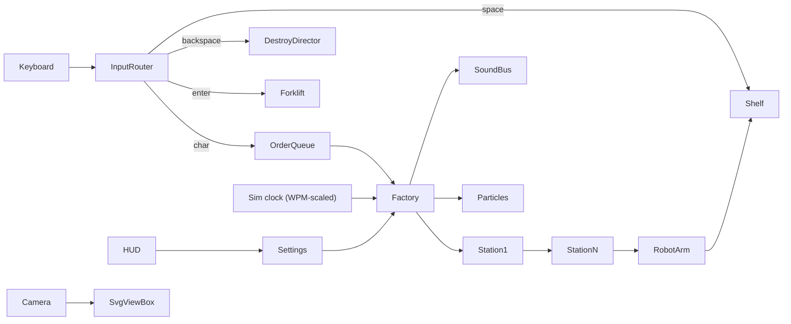

# Letter Factory Line

## Approach: Hairline as a hybrid
Hairline's rules (a 400x320 frame, at most 200 lines, no letters or colour, pointer-only input, no loops of its own) can't hold this concept. So we **reuse the drawing kernel** (`Cam`, `proj`, `rings`, `prism`, `rrect`, `circ`, `spring`, `tween`, `register`, `css(lightDark)`) and build our own full-page engine around it. Its aesthetic carries over: an isometric 2:1 camera, rounded solids, a silhouette plus one crease, and a bright stroke as the accent. We break three rules on purpose: letters on products, keyboard input, and sound.

- Copy `kernel.js` unchanged into `public/hairline/kernel.js` and load it with `next/script` (`beforeInteractive`). It is a classic script that sets `var HL`, so it becomes `window.HL`. Read it through a typed `lib/hl.ts` wrapper. The kernel itself is never edited.

## Stack
- Next.js (App Router) + TypeScript, pnpm. One route, `/`, rendered on the client only (`dynamic(..., { ssr:false })`).
- Rendering: one large SVG world for the machines, which pans and zooms by animating its `viewBox`, plus a full-screen Canvas 2D overlay for particles (sand, sparks, molten glow, liquid, shards, smoke).
- State: a small store (zustand) for HUD settings. The simulation itself runs in plain TypeScript classes outside React.

## Architecture

- **Pipelined production:** every product is a `Job` holding `{char, stage, t}`. Each station is a finite-state machine with `accept(job) / tick(dt) / emit(job)` and capacity 1, joined by conveyor segments with spacing. Many jobs move at once and their order is preserved.
- **Speed:** sim `dt` = real `dt` x `speedMul`, where `speedMul = clamp(1 + wpm/60, 1, 4)` and WPM is a rolling 10s window.
- **Factory interface** (`factories/types.ts`): `{ id, stations[], layout(mode), productRenderer(char), worldOrigin }`. All six factories sit in one world at different origins. Switching product makes the camera pan between buildings over 1.2s.

## Files (key)
- `app/page.tsx`, `app/layout.tsx` (kernel script)
- `lib/hl.ts`: typed access to the kernel
- `engine/world.ts`, `engine/clock.ts`, `engine/job.ts`, `engine/conveyor.ts`, `engine/camera.ts` (overview, follow, cinematic)
- `engine/particles.ts`: canvas pool for sand, spark, liquid, shard, smoke, water, flash
- `engine/glyphs.ts`: single-stroke polylines for A-Z, a-z, 0-9 and punctuation, projected onto curved surfaces (emboss, label, cap)
- `audio/bus.ts` with an `AudioProvider` interface; `audio/synth.ts` (procedural Web Audio: hum, clank, hiss, pour, roar, pump-shotgun rack and blast, glass shatter, typewriter clack/ding); `audio/samples.ts` (stub provider for future base64 samples, not wired yet)
- `factories/bottle/*`: one file per station
- `factories/{can,mug,cookie,neon,brick}/*`
- `shelf/shelf.ts`: multi-row typewriter shelf, auto-wrap, Enter starts a new row
- `fx/shotgun.ts`, `fx/rejectChute.ts`, `fx/broom.ts`, `fx/forklift.ts`, `fx/workers.ts`, `fx/dayNight.ts`, `fx/defects.ts`
- `hud/Hud.tsx`: collapsible panel; `hud/Gauges.tsx`
- `lib/share.ts`: encodes `?w=` text plus settings, and replays on load

## Bottle factory: 13 stations in order
1. Silos: sand, soda ash, limestone, cullet (gates open, granules pour)
2. Weigh hopper and batch mixer (spinning paddles)
3. Furnace (flames, molten glow on canvas, roar)
4. Gob shear (a glowing gob drops)
5. IS machine (blank mould makes the parison, it flips into the blow mould, the letter is embossed here when the emboss mode is on)
6. Annealing lehr tunnel (glass shifts colour from orange to clear)
7. Inspection (camera flash and laser sweep; random defects get kicked out and re-queued)
8. Rinser (bottle inverts, water jets)
9. Rotary filler carousel (dark beverage pour, foam)
10. Crown capper press
11. Labeler (wraps a label printed with the letter)
12. Laser date coder (spark dot line)
13. Robot arm (picks the bottle and places it in the next shelf slot, typewriter ding at row end)

Other factories, each with about 6-8 stations in the same pattern:
- **Can:** coil, cupper, draw/iron, printer, filler, seamer
- **Mug:** clay, wheel, kiln, glaze
- **Cookie:** dough, letter-shaped cutter, oven, icing
- **Neon:** glass tube bent into the letter, gas fill, lights up
- **Toy brick:** injection moulding, stud print

## Input behaviour
- **Character:** a raw-material pour starts a job. `.` gives a cap-only product, `!` an exploding bottle, digits a numbered crate (special chars).
- **Space:** leaves an empty shelf slot (a placeholder job also travels the line so ordering holds).
- **Backspace:** acts on the last slot.
  - Empty slot: an arm removes the gap.
  - Product still on the line, as chosen in the HUD: a QC arm kicks it into the reject chute, or the shotgun shoots it on the conveyor.
  - Product on the shelf: the shotgun drops in, racks, fires, and the bottle shatters with a liquid splash. Then, per the HUD: the slot closes up, or the debris stays until a robot broom sweeps it.
- **Enter:** a new shelf row. When the forklift extra is on, a forklift hauls the full row away.

## HUD (collapsible, top-right)
- Product dropdown (pans to the matching factory)
- Layout: snake / pan-follow / stacked floors / all-active combined (multi-floor snaking factory, camera follows the newest job)
- Letter mark: emboss / label / cap / letter-shaped body / combinations
- Colour: monochrome + accent, or pure monochrome
- Theme: light / dark (`HL.css`)
- Backspace style: close-up or debris + broom; in-flight backspace: reject chute or shoot
- Camera: overview / follow / cinematic
- Toggles: day/night, workers, defects, idle demo (types a phrase after 20s idle), sound plus volume
- Gauges: WPM, units/min, defect rate, line temperature
- Share button (copies the URL)

## Visual language
Every machine is built from `rings` + `prism` solids with a silhouette and a crease. Moving parts (pistons, carousels, arm joints) use kernel springs and tweens through one `register` loop. The accent colour (in accent mode) is limited to molten glass, the furnace, the beverage, neon and the shotgun flash. Workers are tiny stroke figures with hard hats that walk patrol paths.

## Risks
- Performance: 6 factories with hundreds of solids. Only factories in the viewport are rendered or ticked, and static geometry is cached as paths, with only moving parts redrawn.
- Scope is very large for one pass. The build goes in this order: engine, then the bottle factory end to end, then the HUD and extras, then the other 5 factories.
